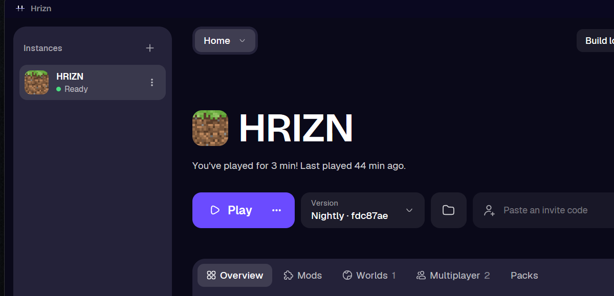

# HRIZN LAUNCHER



HRIZN Launcher is a small desktop launcher for Horizon. It installs a Horizon build, prepares it
from your own copy of Minecraft, keeps it up to date, and starts the game — then stays out of the
way. It is deliberately plain: short menus, quiet screens, no news feed, no sponsor banners, and
nothing collected about you. Everything the launcher needs lives in one folder, and the parts you
will never open stay out of sight.

It is written in Rust with [GPUI Fast](https://github.com/longbridge/gpui-fast), the same UI
framework Horizon's own launcher uses, and ships for Windows, macOS and Linux.

## The original project

HRIZN Launcher is a fork of the launcher that ships with
**[Horizon](https://github.com/horizon-rust/horizon)** — Minecraft: Java Edition 26.3 rewritten in
Rust, with vanilla as its specification. Horizon is a clean-room rewrite of the Java game's client
and server in Rust (wgpu for rendering), together with the tools around it: a dedicated server, a
mod loader, a shader pack format, and a launcher that downloads and prepares the game from the
player's own Minecraft install. All of that work, and the launcher this project started from, is
Horizon's; its source, its release builds and its documentation live at
<https://github.com/horizon-rust/horizon>.

HRIZN keeps Horizon's engine and Horizon's way of preparing and starting the game. What changed is
the launcher's surface, its defaults, and where its own updates come from — not the game.

## How HRIZN differs from the Horizon Launcher

- **Its own updates.** HRIZN's launcher releases are published from this repository
  (`clebmb/hrizn-launcher`), tagged `launcher@X.Y.Z`, with the same archive names Horizon uses.
  Horizon's releases still provide the *game* builds the launcher installs; the launcher itself no
  longer updates from Horizon's release page.
- **Automatic game installs are off by default.** Settings → Updates has "Install new versions
  automatically", now off unless you turn it on. Nothing moves your selected version until you ask
  it to.
- **No community links in the sidebar.** Horizon's Discord button and Website link are gone.
- **One patch note.** The Patch notes page carries a single note, `HRIZN 0.1.0 - INITIAL RELEASE`,
  instead of Horizon's release history.
- **Choose what the menu shows.** Settings → Launcher has two switches: *Show Versions Tab* (on)
  and *Show Patch Notes Tab* (off), which add or remove those entries from the menu under the
  launcher's name.
- **A smaller Appearance card.** The *Launcher theme* and *Home background* settings were removed;
  the accent colour, Dark/Light/System and Reset remain.
- **The name.** "Hrizn Launcher" everywhere the window, the installer, the desktop entry and the
  shortcuts used to say Horizon.

Everything else — versions, instances, mods and modpacks, servers, worlds, accounts, skins, packs,
the command line and the MCP server — works as it does in Horizon's launcher.

## This folder

- `launcher/` — the launcher itself (window, command line, MCP server). Its own Cargo workspace.
- `crates/` — the crates the launcher depends on, copied alongside it so this folder builds on its
  own: `horizon-core`, `horizon-theme`, `horizon-world`, `horizon-prepare`, `horizon-mods`,
  `horizon-mcp`, `horizon-friends`, `horizon-port-pack`, `horizon-release-sign`,
  `horizon-telemetry`, `horizon-protocol`, `horizon-bench`, `horizon-cosmetics`,
  `horizon-shader-api`, `horizon-mod-api-gen`.
- `images/` — the logo, the banner, and the screenshot above.

## Building

```sh
cd launcher
cargo build --release
```

Windows builds need the MSVC toolchain, macOS needs Xcode's command line tools, and Linux needs
`libasound2-dev` and `libudev-dev` (the same requirements as Horizon's launcher; see
`launcher/README.md` for the full list, including NixOS).

## Licence

MIT, the same licence as Horizon. HRIZN Launcher is a derivative work of Horizon's launcher;
copyright in the original code remains with Horizon's authors.
